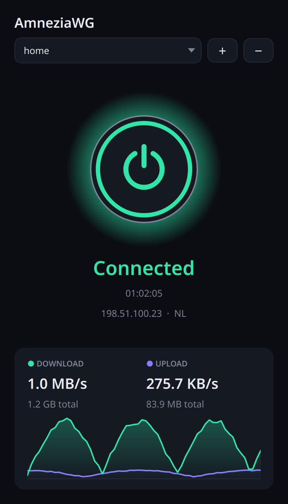
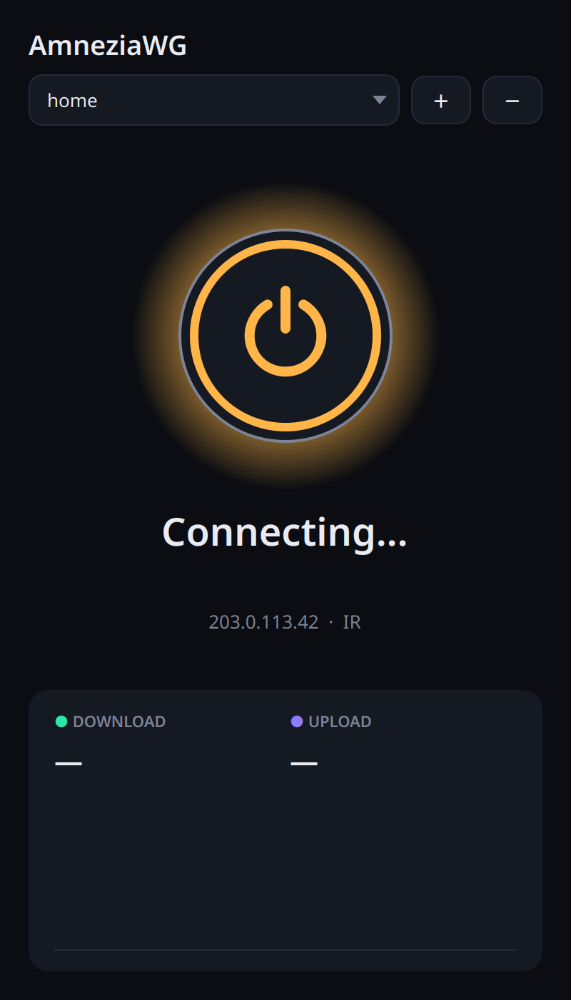
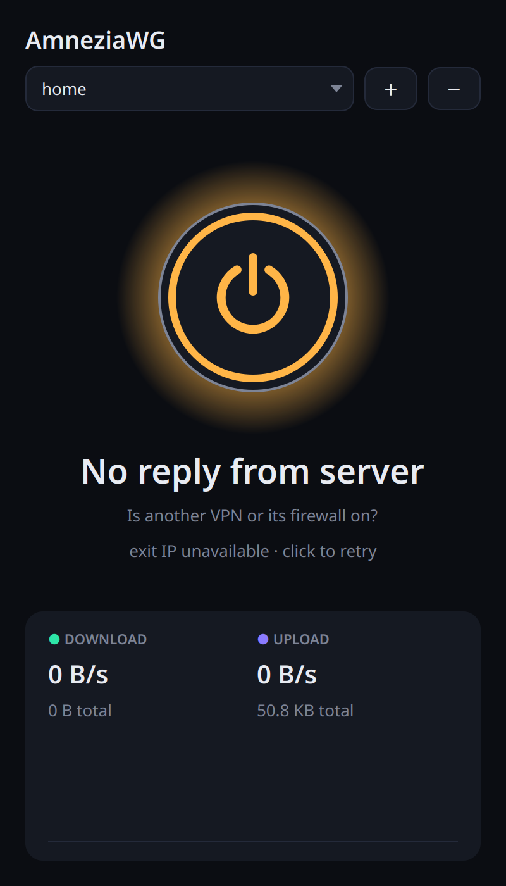
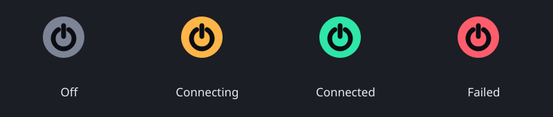
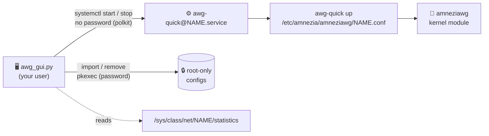

<div align="center">


### A native Linux desktop app for AmneziaWG: import a `.conf`, click the glowing button, you're through.

<a href="https://github.com/P-Khodadust/amneziawg-gui/actions/workflows/selftest.yml"></a>


<a href="LICENSE"></a>

[Install](#-install) · [How it works](#-how-it-works) · [Troubleshooting](#-troubleshooting) · [Known limits](#%EF%B8%8F-known-limits)

</div>

---

A small, single-file desktop client (Python + Qt 6) for [AmneziaWG](https://github.com/amnezia-vpn), the
WireGuard fork with traffic obfuscation that keeps working where plain WireGuard gets blocked. It drives the
official `awg-quick` tooling through systemd, so tunnels are real system services: **closing the window never
drops your VPN**, and the GUI itself never runs as root.

> Unofficial community project, not affiliated with Amnezia. It uses their open-source tools as-is.

## 🤕 The problem

On Linux, AmneziaWG is a command-line affair: `sudo awg-quick up wg0`, a terminal left open, and no idea whether
the tunnel actually passes traffic. "Interface up" is not "connected": a firewall from another VPN, a split
tunnel that routes the server through itself, or an overloaded path can all leave you with a tunnel that
*looks* fine and loads nothing.

## 🪄 The fix

One window, one button, and a status you can trust:

- the button reflects the **systemd** state of `awg-quick@NAME.service`, so it matches reality,
- **"Connected" means bytes are coming back** from the server; if nothing returns within 10 s it says
  **"No reply from server"** instead of pretending,
- the **exit IP and country** are re-checked on every connect and disconnect, so you can see where you appear from.

## ✨ Features

| | |
|:--|:--|
| ⏻ **One-click power button** | glows green when connected, spins amber while connecting, red when it fails (Space/Enter work too) |
| 📈 **Live traffic** | download/upload speed, totals and a 60-second graph, read straight from the kernel |
| 🌍 **Exit IP check** | your public IP and country after every change, via Cloudflare's trace endpoint (no API key, no rate limits) |
| 🩺 **Honest status** | "No reply from server" when the tunnel is up but silent, plus the systemd log when a connect fails |
| 🧭 **Tray icon** | colour shows the state, right-click to connect/disconnect, click to show/hide; closing hides to the tray |
| 📥 **Import & remove** | pick a `.conf`, name it, enter your password once; configs are stored root-only (`0600`) |
| 🔁 **Split-tunnel loop fix** | if your `AllowedIPs` would route the server into its own tunnel, a host route for it is added on import |
| 🛡️ **No root GUI** | a tiny polkit rule lets *only your user* start/stop *only* `awg-quick@*` units, no password |
| 🪶 **Small** | one Python file, no dependencies beyond PySide6, single-instance, tunnels survive the app closing |

## 📸 Screenshots

| | | |
|:-:|:-:|:-:|
|  |  |  |
| **Connected, live traffic** | **Connecting** | **Up, but no reply from server** |

<p align="center"></p>

## 📦 Install

Tested on **Fedora 44, KDE Plasma 6 (Wayland)**.

```bash
git clone https://github.com/P-Khodadust/amneziawg-gui.git ~/amneziawg-gui
cd ~/amneziawg-gui
sudo bash setup.sh "$USER"
sed "s|@APP@|$PWD/awg_gui.py|" amneziawg-gui.desktop > ~/.local/share/applications/amneziawg-gui.desktop
```

`setup.sh` (one time, as root) enables the [`tigro/amneziawg`](https://copr.fedorainfracloud.org/coprs/tigro/amneziawg/)
Copr, installs `amneziawg-tools`, the `amneziawg-dkms` kernel module and PySide6, builds the module for your
running kernel, and adds the polkit rule.

Then open **AmneziaWG** from your app menu, press **+**, pick your `.conf`, and hit the button. ✨

> The Copr is third-party. When this was written, its source tarballs were byte-identical to the official
> `amnezia-vpn` GitHub release tags. Check again before you trust it.

## 🔧 How it works



| File | Role |
|:--|:--|
| `awg_gui.py` | the whole app: window, tray icon, polling, import/remove, exit-IP check, `--selftest` |
| `setup.sh` | one-time root setup: packages, kernel module, polkit rule |
| `amneziawg-gui.desktop` | app-menu launcher template (`@APP@` is filled in at install) |
| `arrow.svg` | the drop-down arrow for the dark theme |

## 🔒 Security model

- **Configs hold private keys**, so they live in `/etc/amnezia/amneziawg/` as `root:root 0600`. The GUI can't read
  them. It only remembers tunnel *names* in `~/.config/amneziawg-gui/tunnels`.
- **The polkit rule is narrow:** one user, a local active session, the verbs `start`/`stop`/`restart`, and unit
  names matching `^awg-quick@[A-Za-z0-9_.-]{1,15}\.service$`. Because you can't write the configs, you can't use
  it to run their `PostUp` hooks as root.
- **Importing and removing** go through `pkexec` and ask for your password every time.

## 🩺 Troubleshooting

<details>
<summary><b>"No reply from server" / connected but nothing loads</b></summary>

Another VPN is usually in the way. Kill-switch firewalls (for example Windscribe's "Firewall") block every
tunnel except their own, and TUN-mode proxies fight over routes. Disconnect them **and** turn their firewall
off, then reconnect.
</details>

<details>
<summary><b>Handshake works, then nothing, and the upload counter explodes</b></summary>

Your config's split `AllowedIPs` covers the server's own IP, so after the first handshake the tunnel's packets
loop back into it. `awg-quick` only protects the server route for `0.0.0.0/0`. The app fixes this on import by
adding a host route for the endpoint. To fix an existing config by hand, add under `[Interface]`:

```ini
PreUp = ip -4 route replace SERVER_IP/32 $(ip -4 route get SERVER_IP | grep -oE '(via [0-9.]+ )?dev [^ ]+' | head -1)
PostDown = ip -4 route del SERVER_IP/32 || true
```
</details>

<details>
<summary><b>Big downloads stall, app updates fail, ping jumps to seconds</b></summary>

That's bufferbloat on the path to your server: at full speed a queue fills up and everything waits behind it.
Cap the tunnel just below that speed with CAKE (needs `iproute-tc`), under `[Interface]`:

```ini
PostUp = ip link del ifbawg 2>/dev/null || true; ip link add ifbawg type ifb && ip link set ifbawg up && tc qdisc add dev %i handle ffff: ingress && tc filter add dev %i parent ffff: matchall action mirred egress redirect dev ifbawg && tc qdisc add dev ifbawg root cake bandwidth 12mbit besteffort || echo "[!] shaping not applied" >&2
PreDown = ip link del ifbawg 2>/dev/null || true
```

Pick a rate around 80% of what the tunnel reaches unshaped. Keep the `|| true`: `awg-quick` runs hooks with
`set -e`, so any failing command stops the tunnel from coming up.
</details>

<details>
<summary><b>WebRTC leaks?</b></summary>

The tunnel is system-wide, so WebRTC's STUN requests go through it and show your VPN's exit IP, not your real
one. A VPN can't change browser behaviour, though. To also hide your local address, set
`media.peerconnection.ice.default_address_only` and `media.peerconnection.ice.no_host` to `true` in Firefox's
`about:config`, or use Google's *WebRTC Network Limiter* extension in Chrome.
</details>

## ⚠️ Known limits

- **Fedora only** for `setup.sh` (dnf + Copr). The app itself runs anywhere with systemd, polkit, PySide6 and `awg-quick`.
- **The kernel module tracks your kernel:** each kernel update also pulls its `kernel-devel` (~60 MB) so DKMS can
  rebuild, and the first install may bring in the newest kernel.
- **One tunnel at a time:** connecting one stops the other, since two full tunnels would fight over routes.
- **The split-tunnel fix** only handles endpoints written as IPv4 addresses, not hostnames.
- **No kill switch and no autostart yet.** If the tunnel drops, traffic goes out directly.

## 🧪 Develop & test

```bash
python3 awg_gui.py --selftest   # name rules, formatting, the split-tunnel fix
```

CI runs the same self-test on every push. Screenshots in this README are the real UI rendered offscreen with
mock tunnel data (documentation IPs).

## 📄 License

[MIT](LICENSE) © 2026 Pouya Khodadust
